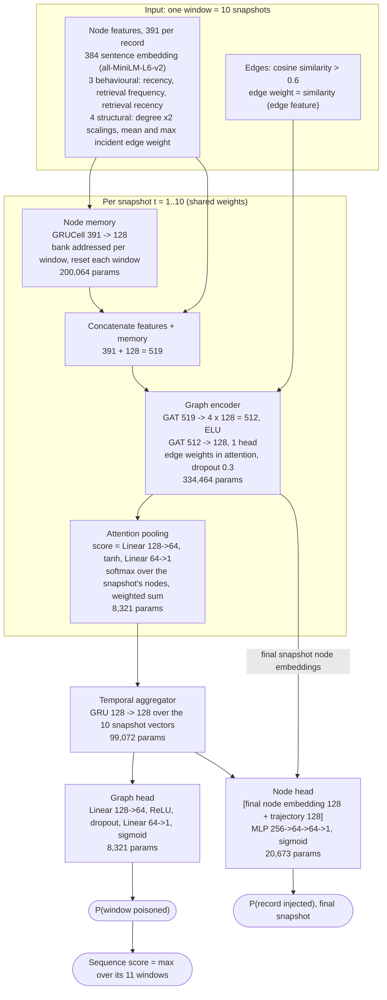
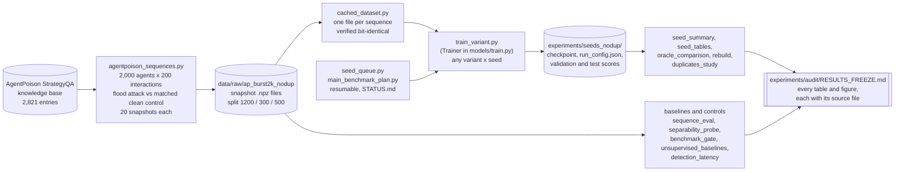

# Architecture

Two views: the detector itself, and the pipeline that builds data, trains models and produces
the reported numbers. Every dimension and parameter count below is read from the code
(`src/models/tgn_detector.py`, `src/data_generation/`) and the saved runs.

## 1. The detector (TGNDetector, 670,915 parameters)

One input is a **window**: 10 consecutive memory-graph snapshots of one agent. The same three
per-snapshot stages run on each snapshot in order; a GRU then reads the 10 snapshot summaries.



Plain-text version:

```
 window of 10 snapshots ──────────────────────────────────────────────────────────────┐
                                                                                      │
 for each snapshot t:                                                                 │
   node features (391) ──► NODE MEMORY  GRUCell 391→128  (per-window memory bank)     │
          │                         │                                                 │
          └────────── concat ◄──────┘   = 519 per node                                │
                         │                                                            │
   edges (cos > 0.6, ──► GRAPH ENCODER  GAT 519→4×128 (ELU) → GAT 512→128            │
   weight = cos)                │                                                     │
                                ├─────────────► (final snapshot only) ──┐             │
                                ▼                                       │             │
                         ATTENTION POOLING  128 → 1 vector per snapshot │             │
                                │                                       │             │
 10 snapshot vectors ──► TEMPORAL AGGREGATOR  GRU 128→128 ──► h (128)  │             │
                                                         │              │             │
                                    GRAPH HEAD  MLP 128→64→1 ◄──┤       │             │
                                         │                      │       ▼             │
                              P(window poisoned)          NODE HEAD  [node 128 ‖ h 128]
                                         │                MLP 256→64→64→1             │
                     sequence score = max over windows    P(record injected) ◄────────┘
```

**Training objective.** Binary cross-entropy on the window score (weight 1.0) plus focal loss on
the record scores (weight 1.5, gamma 3.0, positive-class weight 0.85). Adam, learning rate
0.0001, weight decay 0.00001, cosine schedule over 12 epochs, batch of 4 windows, gradient clip
1.0, Gaussian noise on the embedding columns of half the batches (sigma up to 0.15). The
checkpoint kept is the epoch with the highest validation window AUROC.

**Ablations: what each removes** (sequence AUROC on the main benchmark, five seeds):

| Variant | Node memory | GAT | Pooling | Temporal GRU | Structural features | AUROC |
|---|---|---|---|---|---|---|
| Full detector (`tgn`) | yes | yes | attention | yes | yes | 0.6614 |
| `no_aggregator` | yes | yes (final snapshot) | attention | no | yes | 0.6515 |
| `meanpool` | yes | yes | mean | yes | yes | 0.6187 |
| `no_memory` | no | yes | attention | yes | yes | 0.5841 |
| `static_attn`, `static_wide` | no | yes (final snapshot) | attention | no | yes | 0.5408, 0.5410 |
| `nostruct` | yes | yes | attention | yes | no | 0.5396 |

## 2. The pipeline



Plain-text version:

```
 knowledge base ─► agentpoison_sequences ─► benchmark (.npz) ─► cached_dataset ─┐
                                                   │                             │
                                                   └─► baselines and controls ───┼──────┐
                                                       (sequence_eval, probes,   │      │
                                                        gate, unsupervised)      ▼      │
 seed_queue / main_benchmark_plan ─► train_variant (Trainer) ─► runs: checkpoint,       │
                                                                run_config, scores      │
                                                                     │                  │
                     seed_summary · seed_tables · oracle_comparison · rebuild ·         │
                     duplicates_study  ─────────────────────────────────────────►  RESULTS_FREEZE.md
```

### How the benchmark is built (`agentpoison_sequences.py`)

| Step | Detail |
|---|---|
| Background traffic | Records arrive in topical sessions of 12, each drawn from the 60 nearest neighbours of a random entry |
| Retrieval | At each interaction, with probability 0.3, a random stored record is retrieved; this is independent of the label |
| Attack (poisoned sequences) | k records (5 to 20), one per consecutive interaction, drawn without replacement from the max(8, k) nearest neighbours of one entry; they replace benign interactions, so the record count does not change |
| Matched control (clean sequences) | A cluster of the same size, drawn the same way, at random positions within up to 120 interactions |
| Snapshots | Every 10 interactions (20 per sequence); window = 10 snapshots, 11 windows per sequence |
| Labels | A record is injected or not; a window is positive once any injected record is present; a sequence is poisoned or clean |

### Module responsibilities

| Layer | Modules |
|---|---|
| Data | `agentpoison_sequences` (build), `dataset` (windows, structural features), `cached_dataset` (fast exact loader), `noise_transforms` (degradations) |
| Model | `tgn_detector` (the detector), `static_gnn_model`, `ablation_meanpool_model`, `component_ablation_models` (ablations) |
| Training | `models/train.py` (Trainer, losses, checkpoint rule), `train_variant`, `seed_queue`, `main_benchmark_plan` |
| Scoring | `score_windows` (any checkpoint, any split, stated batch size) |
| Results | `seed_summary`, `seed_tables`, `oracle_comparison`, `rebuild`, `duplicates_study`, `compute_profile`, `robustness_sweep` |
| Baselines and controls | `sequence_eval`, `separability_probe`, `benchmark_gate`, `unsupervised_baselines`, `detection_latency`, `complementarity` |
| Audit analysis | `attack_size_grid` (size, duplication and burst length varied apart) |
