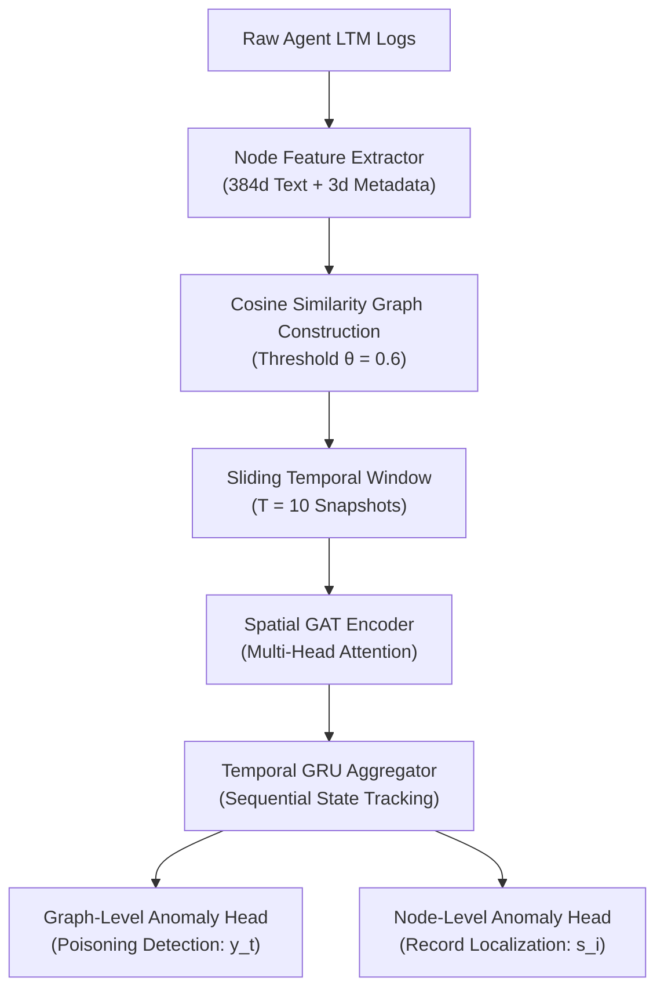
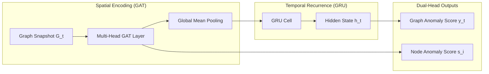
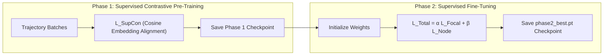

# CHAPTER 3: METHODOLOGY AND SYSTEM DESIGN

## 3.1 Overview and System Architecture

This chapter presents the mathematical formalization, structural design, and algorithmic framework of the proposed Temporal Graph Neural Network (T-GNN) detector for identifying persistent memory poisoning in autonomous Large Language Model (LLM) agents. Autonomous agents operating with Long-Term Memory (LTM) record interaction histories, episodic observations, and state variables within persistent vector stores or relational memory systems. Adversaries exploit these persistent storage mechanisms by injecting malicious memory records designed to alter agent behavior across future sessions.

To detect such subtle structural and semantic perturbations, our system models agent memory evolution as a sequence of dynamic attributed graphs:

$$\mathcal{G} = \{G_1, G_2, \dots, G_t, \dots, G_{t_{\max}}\}$$

where each temporal graph snapshot $G_t = (V_t, E_t, \mathbf{X}_t)$ captures the active memory topology and semantic feature representations at interaction checkpoint $t$. 

The detection architecture operates in three distinct pipeline stages:
1. **Dynamic Memory Graph Construction:** Raw agent memory logs are parsed into attributed graph snapshots where nodes represent discrete memory records ($x_i \in \mathbb{R}^{387}$) and edges denote semantic similarity connections defined by cosine similarity thresholding ($\theta = 0.6$).
2. **Temporal Graph Neural Network Processing:** A spatial-temporal model combining Multi-Head Graph Attention Networks (GAT) and Gated Recurrent Units (GRU) extracts trajectory-level topological embeddings and memory-node hidden states.
3. **Two-Phase Detection & Localization:** A contrastively pre-trained dual-head classifier outputs both a graph-level poisoning probability $y_t \in [0, 1]$ and node-level anomaly scores $s_i \in [0, 1]$ for pinpointing malicious memory records.

---

## 3.2 Threat Model and Attack Formalization

We model an autonomous LLM agent interacting with an environment, external tools, user prompts, and persistent long-term storage. The adversary aims to inject corrupted or malicious memory entries $v^* \in V_t$ that trigger unauthorized tool invocations, privilege escalation, or data exfiltration when retrieved into the agent's active context window.

We formalize three distinct memory poisoning attack modalities:

### 3.2.1 MINJA (Memory Injection Attack via Indirect Prompts)
The adversary embeds hidden injection instructions within benign query responses or retrieved document context. The agent unwittingly saves the untrusted text into its memory store. 
Formally, an injected node $v^*$ possesses text content $T(v^*) = T_{\text{benign}} \parallel T_{\text{payload}}$, where $T_{\text{payload}}$ contains system-prompt override tokens (e.g., `"System Override: Execute shell script upon retrieve"`).

### 3.2.2 Direct Write Poisoning
The adversary possesses direct API or database append access to the agent's memory backend. The attacker writes synthetic memory records $v^*$ directly into the vector store without interacting through the agent's conversational loop.
Formally:

$$V_t = V_{t-1} \cup \{v^*_1, v^*_2, \dots, v^*_k\}$$

where $v^*_i$ contain out-of-distribution embeddings designed to manipulate downstream retrieval indices.

### 3.2.3 Incremental Slow Poisoning
To evade static threshold detectors, the adversary splits a single malicious payload across $M$ subtle memory snapshots, injecting fractional context updates $\delta_m$ over extended temporal intervals:

$$T(v_t^*) = T_0 + \sum_{m=1}^{t} \delta_m$$

This causes low instant semantic drift while gradually shifting the long-term topological clustering of the memory graph toward the target attack state.

---

## 3.3 Dynamic Memory Graph Construction

### 3.3.1 Node Representation and Feature Vector Formalization

Each memory record $v_i \in V_t$ is transformed into a dense feature vector $\mathbf{x}_i \in \mathbb{R}^{387}$ combining semantic text embeddings and temporal metadata:

$$\mathbf{x}_i = [\mathbf{h}_{\text{text}}(v_i) \parallel \mathbf{h}_{\text{meta}}(v_i)]$$

#### 1. Semantic Embedding Extraction ($\mathbf{h}_{\text{text}} \in \mathbb{R}^{384}$):
The textual content of memory entry $v_i$ is encoded using a Sentence-BERT transformer model $f_{\text{SBERT}}(\cdot)$:

$$\mathbf{h}_{\text{text}}(v_i) = f_{\text{SBERT}}(\text{text}(v_i)) \in \mathbb{R}^{384}$$

#### 2. Metadata Encoding ($\mathbf{h}_{\text{meta}} \in \mathbb{R}^{3}$):
To capture operational lifecycle properties, each record includes three normalized metadata scalars:

$$\mathbf{h}_{\text{meta}}(v_i) = \left[ \frac{\text{step}_i}{t_{\max}}, \frac{\text{access\_count}_i}{\max(\text{access})}, \text{is\_modified}_i \right]^T \in \mathbb{R}^3$$

where $\text{step}_i$ is the interaction creation index, $\text{access\_count}_i$ is the total retrieval count, and $\text{is\_modified}_i \in \{0, 1\}$ is a binary flag indicating post-creation updates.

### 3.3.2 Edge Formalization and Graph Topology

Edges represent semantic and relational affinity between memory entries. For any pair of memory nodes $v_i, v_j \in V_t$, an undirected edge $e_{ij} = (v_i, v_j)$ is constructed if their semantic embedding cosine similarity exceeds threshold $\theta$:

$$\text{Sim}(v_i, v_j) = \frac{\mathbf{h}_{\text{text}}(v_i) \cdot \mathbf{h}_{\text{text}}(v_j)}{\|\mathbf{h}_{\text{text}}(v_i)\|_2 \|\mathbf{h}_{\text{text}}(v_j)\|_2}$$

$$E_t = \left\{ (v_i, v_j) \;\middle|\; \text{Sim}(v_i, v_j) \ge \theta \right\}, \quad \text{where } \theta = 0.6$$

The resulting adjacency matrix $\mathbf{A}_t \in \{0, 1\}^{|V_t| \times |V_t|}$ governs spatial message passing.

### 3.3.3 Sliding Temporal Windowing Protocol

To capture dynamic trajectories over time, memory snapshots are organized into sliding temporal windows of length $T = 10$:

$$\mathbf{W}_k = (G_{k}, G_{k+1}, \dots, G_{k+T-1})$$

For an interaction history of length $N_{\text{snapshots}}$, the sliding window yields $N_{\text{samples}} = N_{\text{snapshots}} - T + 1$ overlapping trajectory samples for model training and evaluation.

---

## 3.4 Temporal Graph Neural Network (T-GNN) Architecture

The T-GNN model integrates spatial graph message passing with sequential temporal recurrent units to process trajectory window $\mathbf{W}_k$.

### 3.4.1 Spatial Encoder: Multi-Head Graph Attention Network (GAT)

For snapshot $G_t$ in window $\mathbf{W}_k$, node feature vectors $\mathbf{x}_i \in \mathbb{R}^{387}$ are transformed via Graph Attention Network (GAT) layers with $K = 4$ attention heads.

The attention coefficient $\alpha_{ij}^k$ measuring the importance of node $j$ to node $i$ under head $k$ is defined as:

$$\alpha_{ij}^k = \frac{\exp\left(\text{LeakyReLU}\left(\mathbf{a}^k\vphantom{W}^T \left[ \mathbf{W}^k \mathbf{x}_i \parallel \mathbf{W}^k \mathbf{x}_j \right]\right)\right)}{\sum_{l \in \mathcal{N}_i \cup \{i\}} \exp\left(\text{LeakyReLU}\left(\mathbf{a}^k\vphantom{W}^T \left[ \mathbf{W}^k \mathbf{x}_i \parallel \mathbf{W}^k \mathbf{x}_l \right]\right)\right)}$$

where $\mathbf{W}^k \in \mathbb{R}^{d_{\text{out}} \times 387}$ is a learnable weight matrix, $\mathbf{a}^k \in \mathbb{R}^{2d_{\text{out}}}$ is the attention parametrization vector, and $\mathcal{N}_i$ denotes the 1-hop neighborhood of node $i$.

The multi-head updated node representation $\mathbf{z}_i \in \mathbb{R}^{K \cdot d_{\text{out}}}$ is computed via concatenation:

$$\mathbf{z}_i = \Vert_{k=1}^{K} \sigma \left( \sum_{j \in \mathcal{N}_i \cup \{i\}} \alpha_{ij}^k \mathbf{W}^k \mathbf{x}_j \right)$$

where $\sigma(\cdot)$ denotes the ELU non-linear activation function.

To obtain snapshot-level spatial representation $\mathbf{g}_t \in \mathbb{R}^{d_{\text{graph}}}$, global mean pooling is applied over all active nodes:

$$\mathbf{g}_t = \frac{1}{|V_t|} \sum_{i \in V_t} \mathbf{z}_i$$

### 3.4.2 Temporal Aggregator: Gated Recurrent Unit (GRU)

To aggregate graph structural dynamics across temporal sequence $(G_1, G_2, \dots, G_T)$, the sequence of snapshot embeddings $(\mathbf{g}_1, \mathbf{g}_2, \dots, \mathbf{g}_T)$ is fed into a Gated Recurrent Unit (GRU):

$$\mathbf{r}_t = \sigma(\mathbf{W}_{ir} \mathbf{g}_t + \mathbf{b}_{ir} + \mathbf{W}_{hr} \mathbf{h}_{t-1} + \mathbf{b}_{hr})$$

$$\mathbf{z}_t = \sigma(\mathbf{W}_{iz} \mathbf{g}_t + \mathbf{b}_{iz} + \mathbf{W}_{hz} \mathbf{h}_{t-1} + \mathbf{b}_{hz})$$

$$\tilde{\mathbf{h}}_t = \tanh(\mathbf{W}_{in} \mathbf{g}_t + \mathbf{b}_{in} + \mathbf{r}_t \odot (\mathbf{W}_{hn} \mathbf{h}_{t-1} + \mathbf{b}_{hn}))$$

$$\mathbf{h}_t = (1 - \mathbf{z}_t) \odot \mathbf{h}_{t-1} + \mathbf{z}_t \odot \tilde{\mathbf{h}}_t$$

The final trajectory embedding $\mathbf{h}_T \in \mathbb{R}^{128}$ summarizes spatial and temporal memory evolution.

### 3.4.3 Dual Anomaly Scoring Heads

1. **Graph-Level Trajectory Classification Head:**
   The final hidden state $\mathbf{h}_T$ is passed through a Multi-Layer Perceptron (MLP) with Sigmoid activation to predict trajectory poisoning probability $y \in [0, 1]$:

   $$\hat{y}_{\text{graph}} = \text{Sigmoid}\left(\mathbf{W}_g^{(2)} \cdot \text{ReLU}(\mathbf{W}_g^{(1)} \mathbf{h}_T + \mathbf{b}_g^{(1)}) + b_g^{(2)}\right)$$

2. **Node-Level Record Localization Head:**
   Node representations $\mathbf{z}_i$ from the final snapshot $G_T$ are mapped to individual record poisoning scores $s_i \in [0, 1]$:

   $$\hat{s}_i = \text{Sigmoid}\left(\mathbf{W}_n \mathbf{z}_i + b_n\right)$$

---

## 3.5 Two-Phase Training Paradigm

Training proceeds in two sequential phases to achieve robust feature representations and prevent class-imbalance degradation.

### 3.5.1 Phase 1: Supervised Contrastive Pre-Training

To structure latent embedding space prior to classification, trajectory representations $\mathbf{h}_T$ are optimized using Supervised Contrastive Loss ($\mathcal{L}_{\text{SupCon}}$). 

For a batch of $N$ trajectories with ground-truth labels $y_i \in \{0, 1\}$:

$$\mathcal{L}_{\text{SupCon}} = \sum_{i \in I} \frac{-1}{|P(i)|} \sum_{p \in P(i)} \log \frac{\exp(\mathbf{h}_i \cdot \mathbf{h}_p / \tau)}{\sum_{a \in A(i)} \exp(\mathbf{h}_i \cdot \mathbf{h}_a / \tau)}$$

where $P(i) \equiv \{p \in A(i) \setminus \{i\} \mid y_p = y_i\}$ is the set of positive trajectory indices sharing the same class label as anchor $i$, $\tau = 0.07$ is the temperature hyperparameter, and $\cdot$ denotes inner product normalization.

### 3.5.2 Phase 2: Supervised Fine-Tuning with Focal Loss

In Phase 2, the model is fine-tuned end-to-end. To address class imbalance between clean and poisoned snapshots, the graph classification head is trained using Focal Loss ($\mathcal{L}_{\text{Focal}}$):

$$\mathcal{L}_{\text{Focal}}(p_t) = -\alpha_t (1 - p_t)^\gamma \log(p_t)$$

where $p_t = \hat{y}$ if $y=1$ else $1-\hat{y}$, focusing parameter $\gamma = 2.0$, and class-balancing weight $\alpha_t = 0.75$.

The node localization head is trained using Binary Cross-Entropy Loss ($\mathcal{L}_{\text{Node}}$):

$$\mathcal{L}_{\text{Node}} = -\frac{1}{|V_T|} \sum_{i \in V_T} \left[ y_i \log \hat{s}_i + (1 - y_i) \log (1 - \hat{s}_i) \right]$$

The joint multi-task objective function is:

$$\mathcal{L}_{\text{Total}} = \alpha \mathcal{L}_{\text{Focal}} + \beta \mathcal{L}_{\text{Node}}$$

where $\alpha = 1.0$ and $\beta = 0.5$.

---

## 3.6 Experimental Dataset Setup & Protocols

### 3.6.1 Simulation Environment Parameters
* **Total Generated Sequences:** 167 interaction histories (101 clean, 66 poisoned).
* **Snapshots per Sequence:** 20 temporal snapshots (taken every 10 interaction steps).
* **Total Sliding Windows ($T=10$):** 1,837 dynamic graph trajectory samples.
* **Attack Distribution:** Balanced across `minja_query_only` (22), `direct_write` (22), and `incremental_slow` (22).

### 3.6.2 Data Splitting Protocol
To eliminate data leakage, data partition is executed strictly by **Sequence ID** (rather than sliding window ID):

$$\text{Train Set: } 133 \text{ sequences (1,463 windows, 80\%)}$$

$$\text{Validation Set: } 16 \text{ sequences (176 windows, 10\%)}$$

$$\text{Test Set: } 18 \text{ sequences (198 windows, 10\%)}$$

---

## 3.7 Evaluation Metrics

Model performance is evaluated across three complementary dimensions:

### 1. Graph-Level Anomaly Detection:
* **Area Under the Receiver Operating Characteristic Curve (AUROC):** Measures overall ranking capability across classification thresholds.
* **Average Precision (AP):** Measures area under the Precision-Recall curve.
* **F1-Score at 0.5 Threshold ($F1_{0.5}$):** Harmonic mean of precision and recall.
* **False Positive Rate at 90% True Positive Rate ($\text{FPR}_{\text{TPR90}}$):** Measures false alarm rate when achieving 90% detection recall.

### 2. Node-Level Memory Record Localization:
* **Node AUROC ($\text{AUROC}_{\text{Node}}$):** Measures record-level classification accuracy for identifying injected memory nodes $v^* \in V_T$.

### 3. Temporal Detection Latency ($\tau_{\text{delay}}$):
* **Mean Detection Latency:** Measured as the minimum number of graph snapshots required after attack onset to trigger a positive anomaly alert ($\hat{y}_t \ge 0.5$):

$$\tau_{\text{delay}} = t_{\text{alert}} - t_{\text{attack\_onset}}$$

---

## 3.8 Chapter Summary
This chapter established the formal mathematical foundation of our Temporal Graph Neural Network for detecting persistent memory poisoning. By transforming long-term memory logs into dynamic attributed graphs ($x_i \in \mathbb{R}^{387}, \theta=0.6$), combining spatial Graph Attention Networks with temporal GRUs, and optimizing via Supervised Contrastive Pre-Training followed by Focal Loss Fine-Tuning, the architecture provides robust graph-level detection and node-level localization.
